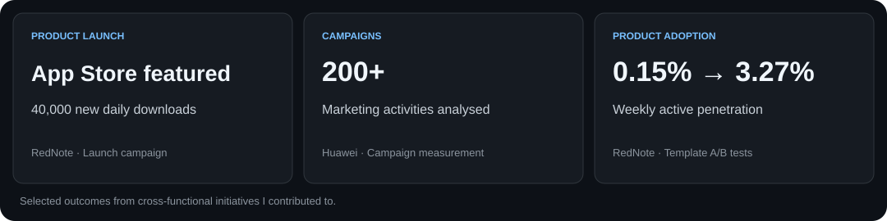

# Hi, I'm Luca 👋

**Software development · Product insight · Go-to-market engineering**

I've recently completed a Master's degree in Software Development at Victoria University of Wellington, following product and growth roles at **RedNote, LINE and Huawei**. I enjoy building small projects with AI, learning as I go, and connecting with people through shared ideas and curiosity.

Based in **Wellington, New Zealand**.

[Portfolio ↗](https://personal-web-li-16ac.vercel.app/) · [LinkedIn](https://www.linkedin.com/in/luca-li2052/) · [GitHub](https://github.com/lucas2052)

---

## What I've been building

### [Auction Platform](https://github.com/lucas2052/Auction-Platform)

A web-based auction project built with Python.

### Tool Sharing System · Java desktop application

A desktop application for listing, finding, borrowing and returning tools, built with **Java Swing, JDBC and MySQL**.

- Separates the user interface, service logic and database access into distinct layers.
- Supports keyword and category search, tool listings, borrowing dates and order tracking.
- Validates borrower identity and order status before returns, and coordinates order closure, tool availability and deposit refunds within a database transaction, with rollback on failure.

### [MusicMatch](https://github.com/lucas2052/MusicMatch) · Full-stack project

A music taste matching app built with **React and Node.js / Express**.

- Represented audio characteristics across **three acoustic dimensions** and used Euclidean distance to calculate user similarity scores.
- Deployed the frontend on **AWS S3** and backend on **EC2**, with CI/CD for repeatable delivery.

### [Personal website](https://github.com/lucas2052/personal-web)

My portfolio and a place to share my work. **[Visit the site ↗](https://personal-web-li-16ac.vercel.app/)**

## Skills in context

| Area | Technologies and practices |
| :--- | :--- |
| Frontend | React, Next.js, JavaScript, TypeScript |
| Backend and applications | C#, ASP.NET Core, Node.js, Express, Python, Java, Swing, JDBC, REST APIs |
| Data and delivery | SQL, Supabase, PostgreSQL, MySQL, Docker, AWS S3 / EC2, Git, CI/CD |
| AI and optimisation | OpenAI API, structured prompting, Google OR-Tools |
| Product and collaboration | User interviews, requirements, user stories, PRDs, A/B testing, funnel analysis, Agile delivery |

---

## Go-to-market & growth

